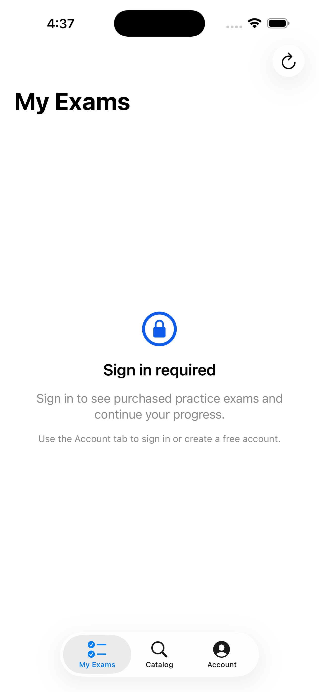

# AI Exams iOS

Native SwiftUI client for Tertiary Exams mobile practice.

<a href="https://apps.apple.com/us/app/id6781995308">
  
</a>

**Now live on the App Store** → [Certificate Practice Exams](https://apps.apple.com/us/app/id6781995308)

<p>
  
</p>

## Scope

The app is for customers to take the practice exams they already own, on the move.
Buying, vouchers and account administration happen on the website; the app has no
catalog, checkout or admin features.

- Sign in with a 6-digit email code (or a password); create an account with full name + email.
- **My Exams** — every practice exam linked to the account, with best/latest score and
  one tap into **Exam mode** (timed) or **Practice mode**; resume unfinished attempts.
- **Exam mode** — countdown, Flag for review, Review Screen, auto-submit at time-up.
- **Practice mode** — check each answer for the explanation and exam domain.
- **Results** — PASS/FAIL, per-domain breakdown, full answer review, Retake.
- **History** — best/average/latest per certification and every attempt.
- **Account** — sign out, delete account, privacy policy.

## Build

The Xcode project is generated with XcodeGen:

```sh
xcodegen generate
xcodebuild -project AIExams.xcodeproj -scheme AIExams -destination 'generic/platform=iOS Simulator' build CODE_SIGNING_ALLOWED=NO
```

### Install on a connected iPhone

```sh
xcodebuild -project AIExams.xcodeproj -scheme AIExams -configuration Debug \
  -destination 'id=<device-udid>' -allowProvisioningUpdates -derivedDataPath build
xcrun devicectl device install app --device <device-udid> \
  build/Build/Products/Debug-iphoneos/AIExams.app
```

The app points at `https://exams.tertiaryinfotech.com` by default in `AIExams/Services/APIClient.swift`.
